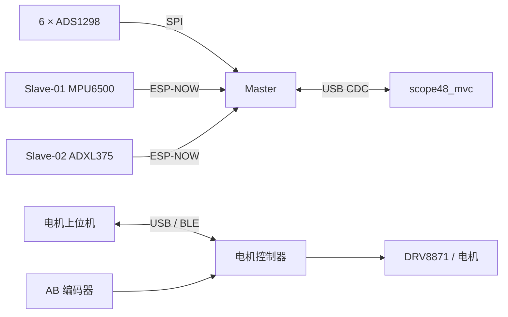

# 系统架构与实现指南

核对日期：2026-10-19。

## 1. 四个独立固件

| 目标 | 入口 | 主体 | 职责 |
| --- | --- | --- | --- |
| `master` | [main.cpp](../src/master/main.cpp) | [MasterApp](../lib/master_node/master_node.h) | 6 颗 ADS1298 / 48CH / 2 kSPS、同步、接收 IMU、USB 输出 |
| `slave-01` | [main.cpp](../src/slave-01/main.cpp) | [ImuSlaveApp](../lib/imu_slave_node/imu_slave_node.h) | MPU6500 三轴角速度，source=0x01 |
| `slave-02` | [main.cpp](../src/slave-02/main.cpp) | 同一个 ImuSlaveApp | ADXL375 三轴加速度计数，source=0x02 |
| `motor` | [main.cpp](../src/motor/main.cpp) | [MotionController](../src/motor/motion_controller.h) | 编码器反馈、回撤、速度闭环、速度突降检测、USB/BLE 命令 |

Master 和 Slave 共用 [capture_common](../lib/capture_common/capture_common.h)。电机使用独立文本协议，不通过 Master 或 ESP-NOW 执行实时闭环。

## 2. 采集状态与线程

采集链路按 `IDLE → SYNC → STREAM_PENDING → STREAM` 运行，STOP 返回 IDLE。START_STREAM 携带约 500 ms 后的 Master 开始时刻，让各节点在同一时间轴启动。

Master 创建四个任务：

- `masterWireless`：Beacon、无线收包解码、ACK、状态与同步消息。
- `serialCommand`：读取上位机的按行文本命令。
- `serialTx`：合批发送 EMG、透传 IMU、发送诊断和状态事件，并服务 PC 重发。
- `masterSensor`：DRDY 通知后读取 48 路 ADC 值，放入本地队列。

Slave 分为采样任务和无线任务。当前两板 INT 均未连接，因此用 ESP32 1 ms 硬件定时器唤醒采样任务；中断仅发通知，SPI 在任务中执行。20 点构成一批，先进入环形缓冲，再按发送窗口发给 Master。

## 3. 同步与可靠传输

Slave 从 Beacon 获取 Master 信息，并主动发送双向同步探针，拟合本地时钟与 Master 时间的关系。同步计算使用快照，避免在长临界区内做浮点拟合和排序。

Master 校验 IMU 批次、去重并发送连续 ACK 基准及 32 位位图。Slave 保存未确认批次并重传；本地漏采或缓冲溢出通过样本序号与故障标记体现。Master 转发 USB 时使用压缩 IMU wire batch，避免展开为 20 个大样本。

两个 Slave 默认 80 MHz；待机和采集使用 20 ms / 50 ms 接收窗口，同步与等待开始保持持续接收，双向同步交换期间临时保持射频唤醒。窗口设置不等于整机电流或温度的固定降幅。

## 4. 两个上位机

- [scope48_mvc.py](../tools/scope48_mvc.py)：手动串口连接、48CH 显示、Gyro/Accel、MVC 标定与反馈、录制、停止后分析和波形输出。
- [motor_controller.py](../tools/motor_controller.py)：调用 [hammer_gui.py](../tools/hammer_gui.py)；通信由 [hammer_transport.py](../tools/hammer_transport.py) 完成，解析与轨迹指标由 [hammer_protocol.py](../tools/hammer_protocol.py) 完成。

采集界面显示滤波或原始信号，录制保留原始计数。MVC 是一组 16 通道 RMS 中位数归一化后的 EMG 幅值比例，不是力或转矩百分比。

## 5. 配置应改在哪里

| 需求 | 文件 |
| --- | --- |
| Flash / PSRAM、USB 模式、构建目标 | [platformio.ini](../platformio.ini) |
| Master 引脚 | [src/master/main.cpp](../src/master/main.cpp) |
| ADS 通道数、增益、RLD、测试信号 | [ads1298_48ch_driver.cpp](../lib/ads1298_48ch_driver/ads1298_48ch_driver.cpp) 顶部配置区 |
| Slave source、GPIO、CPU | 各自 `src/slave-01/02/main.cpp` |
| Slave 采样周期、接收窗口和发送调度 | [imu_slave_node.h](../lib/imu_slave_node/imu_slave_node.h) 与对应 cpp |
| 电机引脚、周期、默认控制参数 | [control_config.h](../src/motor/control_config.h) |
| 上位机五档 | [hammer_profiles.json](../hammer_profiles.json) |
| 环境与启动任务 | [pixi.toml](../pixi.toml) |

具体数值见 [硬件接线与参数](硬件接线与参数.md)。
